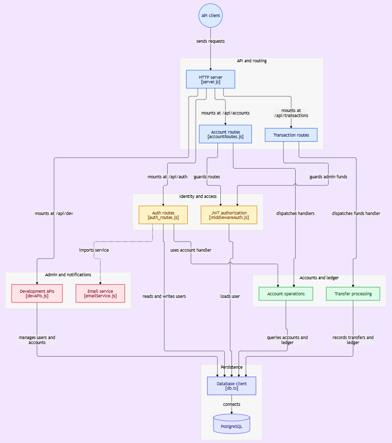

# Bank ledger server

This is an Express backend for ledger accounts, user authentication, and account-to-account transactions. The principal workflow is registration/login, authenticated account access, then a transfer that validates accounts and idempotency, derives balance from ledger entries, and records transaction and ledger rows.

## Tech Stack

-Prisma ORM
-NodeJS

## Project overview

  

